# Montra — Personal Finance

A mobile-first personal finance app built from the Montra Figma design: transactions, accounts, budgets, reports, savings goals, notifications and settings.

Montra is **local-first**. Everything is stored in this browser's IndexedDB. There is no server, no bank connection, no sync, no real authentication and no encryption. It's a portfolio project, not a production finance app.

| Home | Transactions | Add transaction | Budgets |
| --- | --- | --- | --- |
| 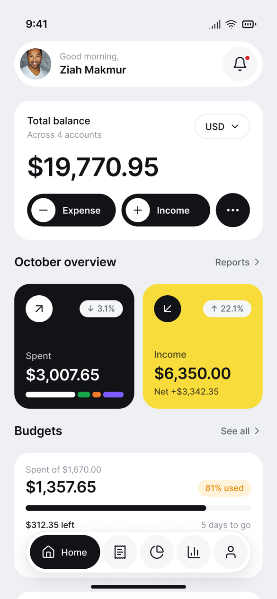 | 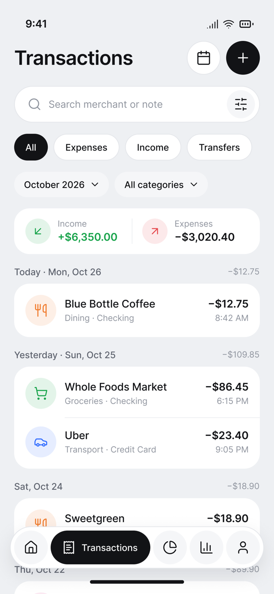 | 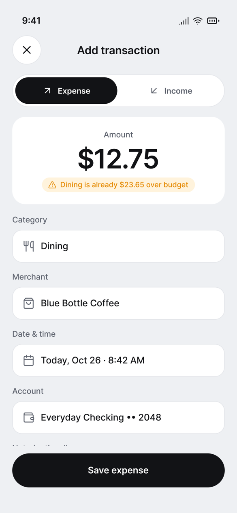 | 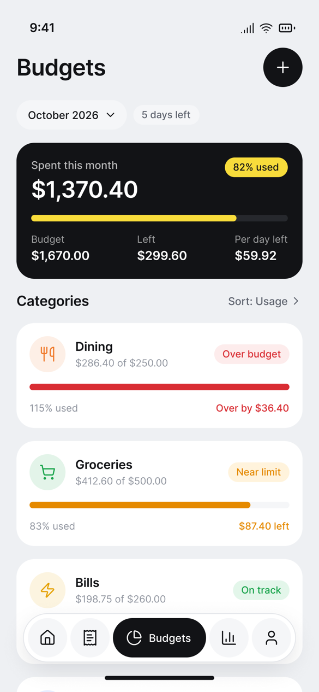 |
| **Budget details** | **Reports** | **Goal details** | **Accounts** |
| 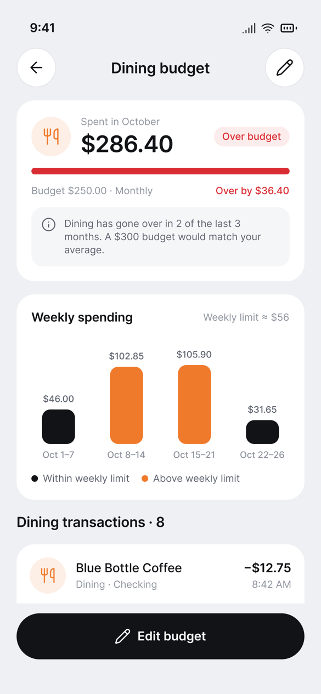 | 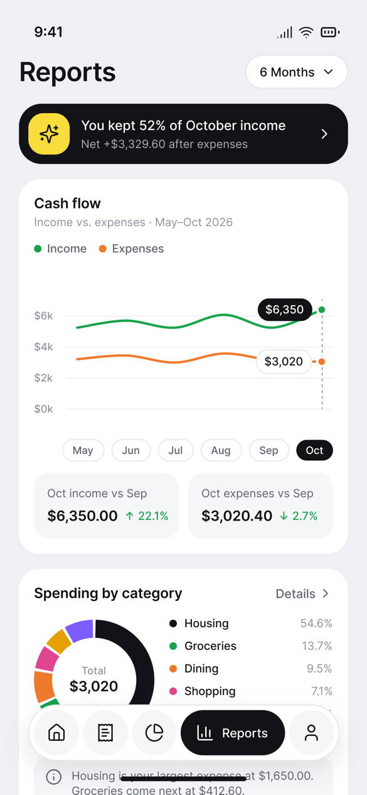 | 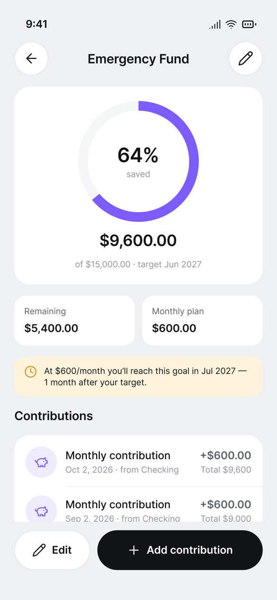 | 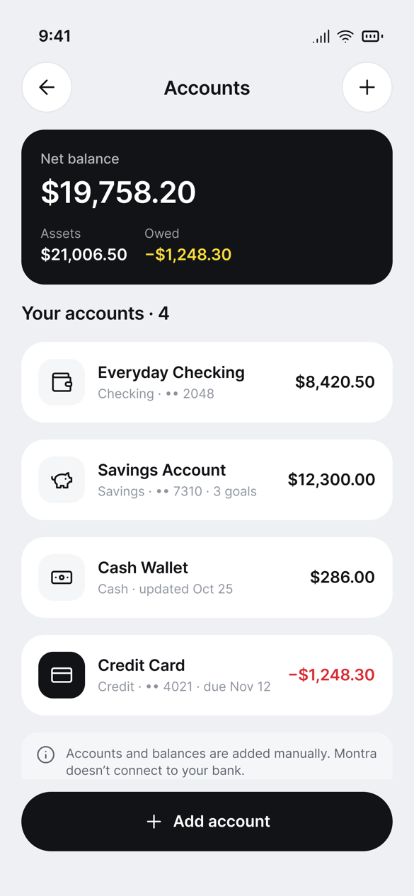 |

<sub>The screenshots are the Figma design frames (the export at 1/3 scale). The running app reproduces their figures from the sample data.</sub>

## Run it

```bash
npm install
npm run dev        # http://localhost:3000
npm test           # Vitest: domain rules and seed reconciliation
npm run typecheck
npm run lint
npm run build
```

## Stack

- **Framework:** Next.js 16 (App Router, Cache Components) with React 19 and TypeScript in strict mode.
- **Styling and icons:** Tailwind CSS v4 with the Figma design tokens as CSS variables, plus `lucide-react` icons.
- **Charts:** hand-written SVG; there is no chart library.
- **Tests:** Vitest.

## Architecture

Montra is a client-rendered single-page app delivered by Next.js. The server sends a static shell and every screen; all data is read and written in the browser. The code is split into layers that only depend downward:

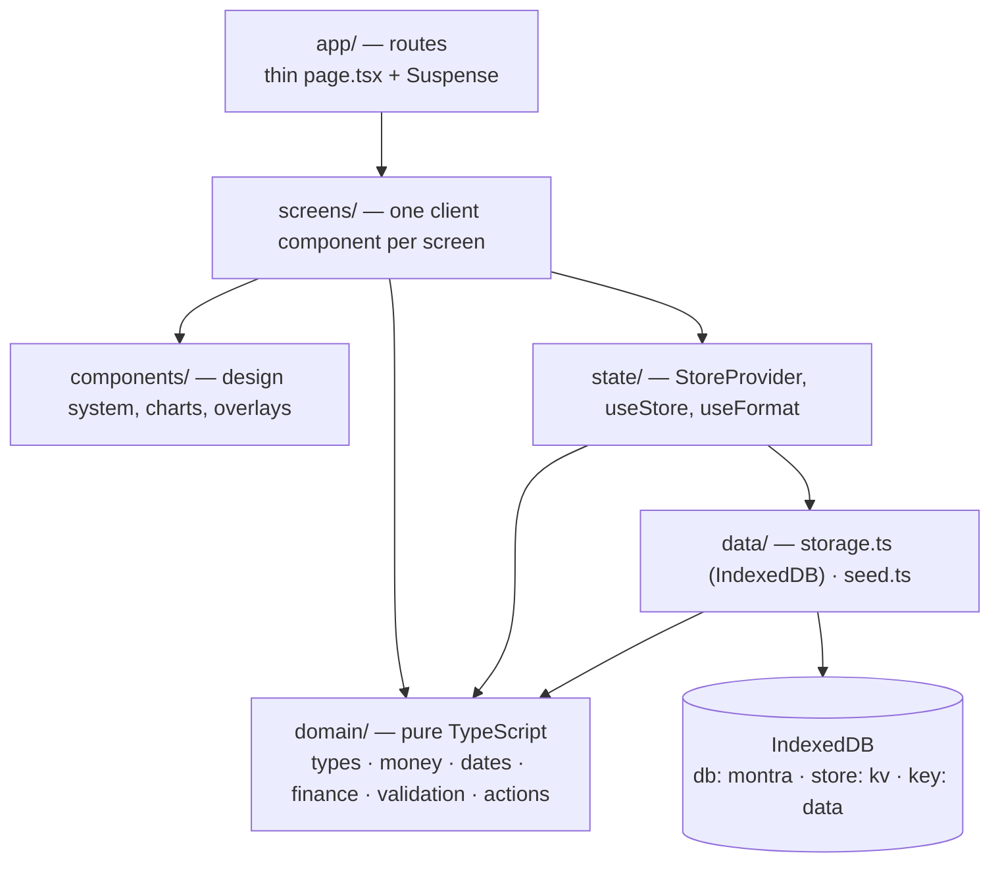

| Layer | Knows about | Never touches |
| --- | --- | --- |
| `domain/` | Plain data and functions | React, the DOM, IndexedDB, the clock (time comes in through `Ctx`) |
| `data/` | `domain/` types, IndexedDB | React |
| `state/` | `domain/`, `data/`, React context | Screen layout |
| `components/` | Design tokens, Lucide icons | Financial rules |
| `screens/` | Everything above | Raw totals — they call `finance.ts` instead of adding numbers themselves |
| `app/` | Which screen a URL renders | Any logic |

### Folder structure

```
src/
  app/                    Routes (App Router). Each page.tsx renders one screen in <Suspense>
    layout.tsx            Inter font, metadata, <Providers>
    page.tsx              /            → HomeScreen
    welcome/, sign-in/    Onboarding
    transactions/         list · new · [id] · [id]/edit
    budgets/              list · new · [id] · [id]/edit
    reports/              overview · categories
    savings/              list · new · [id] · [id]/edit
    accounts/             list · new · [id]
    notifications/, profile/
  screens/                Client screens (forms, lists, details, sheets)
  components/
    ui.tsx                Button, IconButton, Tag, FilterChip, Segmented, Toggle, InputField, PickerField,
                          SearchField, TopBar, Card, ListRow, ProgressBar, EmptyState, Banner…
    overlays.tsx          Sheet (bottom sheet), ConfirmDialog, ToastProvider/useToast
    Shell.tsx             Screen frame, floating BottomNav, Spinner
    charts.tsx            LineChart, Donut, Ring, WeekBars (hand-written SVG)
    TransactionRow.tsx    Shared transaction list row
    Providers.tsx         Store + toasts + onboarding gate
    Icon.tsx              Explicit Lucide icon map
  state/
    store.tsx             Loads IndexedDB, exposes data/apply/set, persists every change
    format.ts             Money/date formatters bound to the date-style setting
  domain/
    types.ts              Data model
    money.ts              Integer cents, parsing, formatting, per-currency sums
    dates.ts              Local date strings, month/week ranges, formatters
    finance.ts            All calculations (balances, reports, budgets, goals)
    validation.ts         Form rules shared by UI and actions
    actions.ts            Pure state transitions + generated notifications
    categories.ts         Fixed categories with Figma colours and icons
  data/
    storage.ts            IndexedDB load/save, validation, migration, corrupt-data backup
    seed.ts               October 2026 sample data reconciled to the Figma figures
```

### Data model

Everything is stored as one versioned `MontraData` document.

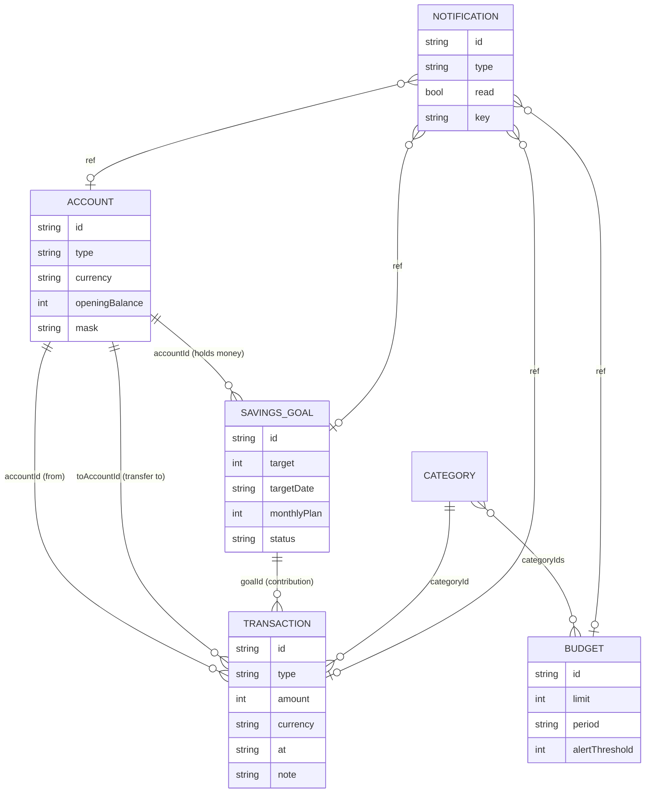

- **Facts only.** Records store what happened (transactions, opening balances, limits, targets). Balances, budget spending and goal progress are never stored; `finance.ts` derives them every render, so an edit or delete can't leave a stale or double-counted total.
- **Money** is an integer number of minor units plus a currency code. Floats are never used for amounts.
- **Dates** are local strings (`2026-10-26T08:42`), so a transaction stays on the day the user picked regardless of time zone.
- **Transactions** have one shape for all three types. A savings contribution is a `transfer` with `goalId` set.
- **Categories** are a fixed list in code (`categories.ts`), not user data.
- **Notifications** carry an optional `key` (e.g. `budget:b-dining:2026-10-01:over`) used to avoid generating the same alert twice.

### Write path

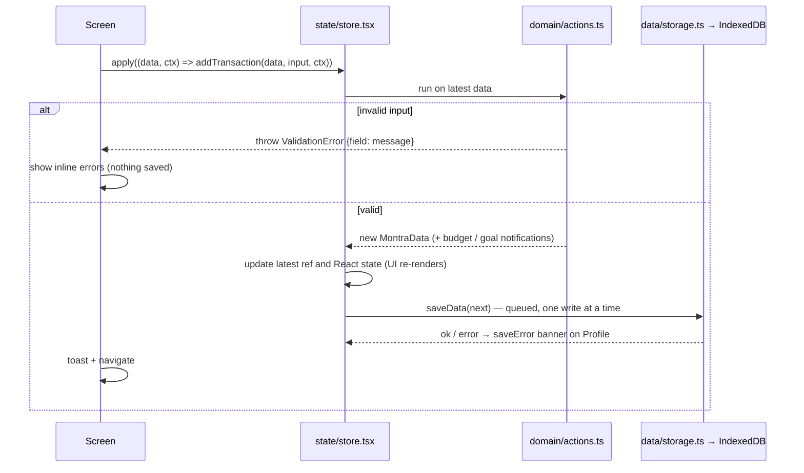

- Actions are **pure**: `(data, input, ctx) → { data, … }`. `ctx` supplies the timestamp, local "now" and id generator, which keeps actions deterministic in tests.
- The store keeps a `latest` ref so quick successive actions (e.g. delete then Undo) always build on the newest data.
- Writes go through a serialized queue so an older save can never overwrite a newer one.
- Undo is just another action: `restoreTransaction` puts the removed record back.

### Read path and rendering

1. `page.tsx` (server) renders the screen inside `<Suspense>`; routes set `instant = false` because content depends on IndexedDB.
2. `Providers` mounts `StoreProvider`, which calls `loadData()`:
   - empty database → seeds the sample data;
   - invalid or unreadable data → backs it up under `data:corrupt:<timestamp>` and reseeds;
   - IndexedDB unavailable → runs in memory.
3. The clock is read only after mount (`today`), so prerendered HTML has no time-dependent values.
4. The onboarding gate shows a spinner until data is ready, then redirects to `/welcome` if the profile hasn't onboarded.
5. Screens read `data` from `useStore()` and call `finance.ts` (`netWorth`, `periodTotals`, `spendingByCategory`, `monthlySeries`, `budgetProgress`, `budgetSummary`, `weeklySpending`, `goalProgress`) to get every number they show.

### Routes

| Route | Screen | Notes |
| --- | --- | --- |
| `/welcome`, `/sign-in` | Onboarding | Sign-in only sets a local profile |
| `/` | Home | Balance per currency, month overview, budgets, savings, recent |
| `/transactions` | List | Search, type/month/category/account filters, day groups |
| `/transactions/new?type=` | Add | Expense, income or transfer |
| `/transactions/[id]`, `/edit` | Details / edit | Delete with confirm + Undo toast |
| `/budgets`, `/new`, `/[id]`, `/[id]/edit` | Budgets | Month picker, sort, weekly bars |
| `/reports?p=&from=&to=` | Reports | Period lives in the URL so it survives navigation |
| `/reports/categories` | Category breakdown | Shares the report period |
| `/savings`, `/new`, `/[id]`, `/[id]/edit` | Goals | Contribution sheet on details |
| `/accounts`, `/new`, `/[id]` | Accounts | Update balance, rename, delete when unused |
| `/notifications`, `/profile` | Alerts, settings | Theme, currency, date style, export, reset |

### UI system

- **Tokens** live as CSS variables in `globals.css` (colours, radii, shadows) and are mapped into Tailwind's theme; dark mode swaps the variables under `[data-theme=dark]`.
- **Type scale** uses named classes (`t-balance`, `t-title`, `t-body`…) matching the Figma text styles.
- **Overlays:** bottom sheets close on Escape or scrim; confirm dialogs use `role="alertdialog"`; toasts are announced through `aria-live` and sit above the bottom nav.
- **Charts** are plain SVG with an `aria-label` summary, so there's no chart dependency.

### Testing

- `src/data/seed.test.ts` reconciles the sample data with every figure in the design (balances, October totals, category split, budgets, goal progress and projection).
- `src/domain/finance.test.ts` covers the rules: transfers excluded from income/spending, edit/delete/restore, budget states and de-duplicated alerts, contributions and milestones, validation errors.
- The UI was checked manually in the browser; there are no automated end-to-end tests yet.

### Startup and failure handling

`Providers` waits for IndexedDB and shows a spinner until it's ready. First-time visitors go to `/welcome`. If the stored data is corrupt, it's backed up under `data:corrupt:<timestamp>` and the app starts again from the sample data. If IndexedDB is unavailable, the app runs in memory and the Profile screen warns that changes won't be kept.

## Calculation rules

- **Money:** amounts are integer minor units (cents) with a currency. Totals are always grouped by currency and never converted.
- **Account balance:** opening balance + income − expenses − transfers out + transfers in.
- **Net balance:** the sum of account balances per currency. Assets are the positive balances; owed is the negative ones (credit cards).
- **Income and expenses for a period:** only income and expense transactions count. Transfers, including savings contributions, are never income or spending.
- **Budgets:** spent = expenses in the budget's categories during its current period (a calendar month, or a Monday–Sunday week). The state is:
  - *near limit* at the alert threshold (80%);
  - *over budget* above 100%.

  The monthly summary counts each expense once, and per-day-left = remaining ÷ days left in the month.
- **Savings goals:**
  - A contribution is a real transfer into the goal's account, tagged with the goal.
  - Saved = the sum of those transfers; contributions can't exceed what's still needed.
  - The projected finish month comes from the monthly plan.
  - Milestone notifications fire at 25/50/75/100%.
- **Updating a balance** adjusts the account's opening balance, so a correction never shows up as income or spending.
- **Deleting a goal** keeps the money where it is; its contributions become plain transfers.

## Features

- **Transactions:**
  - Add, edit and delete expenses, income and transfers. Delete goes through a confirmation dialog and offers an Undo toast.
  - Search, filter by type, month, category and account, with daily groups and day totals.
  - Empty and no-results states.
- **Add transaction:** shows a live budget hint (for example "Dining is already $36.40 over budget"), validates every field inline, and uses a category picker sheet.
- **Budgets:**
  - A monthly summary, sorting, and browsing past months.
  - A details screen with weekly bars against the weekly limit, a 3-month insight and the matching transactions.
  - Create, edit (weekly or monthly, alert toggle) and delete.
- **Reports:**
  - Report periods: this month, last month, 3 or 6 months, this year, or a custom range.
  - A cash-flow line chart with month selection and month-over-month comparison.
  - A category donut and a spending-by-category details screen.
- **Savings:** a goal list, goal details with a progress ring and projection, an add-contribution sheet (presets, source account, new total), and create, edit and delete.
- **Accounts:** net balance, assets and owed; account details with money in and out for the month; update balance; rename and delete (only when unused); add account (type, currency, last 4 digits).
- **Notifications:** filters, Today / This week / Earlier groups, mark all as read, and tapping a notification opens its record. Budget alerts are generated automatically and deduplicated per budget per period.
- **Profile:**
  - Edit name and email, default currency, date format (US or international), budget alerts and dark mode.
  - Export data as JSON, reset sample data, and sign out.

## Differences from the design

- **Transfers:** the Add Transaction segmented control has a third **Transfer** option (the design shows only Expense and Income).
- **Delete:** the design's dialog says the delete "can't be undone"; Montra deletes and then offers **Undo** in the toast.
- **Sign in:** this only sets a local name and email. No password is collected or checked, and the passkey button isn't shown.
- **Unbuilt settings:** App passcode is shown as *Not available* and Face ID as *Coming soon*. Language is English only.
- **Avatar:** the profile shows the user's initials, not a photo.
- **Not implemented:** custom budget periods, the "Include in net balance" toggle for accounts, and share images.
- **Time-dependent text:** the clock is real. With today's date the app shows the same October 2026 figures as the design; on other dates, "Today", "days left" and similar labels move with the clock.

## Limitations

- Data lives in one browser profile only. Clearing site data deletes it; use **Export data** to keep a copy.
- There is no multi-currency conversion, no recurring transactions, no custom categories and no attachments.
- The app isn't production-ready: there's no auth, encryption, backup or sync, and no automated end-to-end tests. The UI was checked by hand in a browser.
